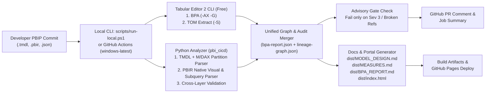

# Power BI PBIP CI/CD Pipeline — Implementation Plan (Phase 1)

> Tracked copy of the approved Phase 1 implementation plan for `Admin Monitoring dashboard.pbip`.

## Goal Description

Design and implement a local-first, GitHub Actions–ready **CI/CD pipeline** for the Power BI Project (`Admin Monitoring dashboard.pbip`) inside `Power BI CI CD Project/`.

**Phase 1** focuses on **local validation** and a **personal GitHub repository** (`hieutc2308` — GitHub Actions CI + PR Summaries + GitHub Pages) using the native-visual **Admin Monitoring dashboard** model (`8` tables, `58` columns, `62` measures, `3` relationships, `2` `NamedExpression` objects, `5` report pages, `130` native visuals across `18` visual types, `15` bookmarks). **Phase 2** (Fabric Deployment Pipelines via `fabric-cicd` / `fab` CLI and Jira integration via `twg` CLI) is documented cleanly as extension hooks.

### Confirmed Decisions
- **Target PBIP**: `Admin Monitoring dashboard.pbip` (prioritizes standard native Power BI visuals).
- **Advisory Gate Severity**: Keep `DAX_COLUMNS_FULLY_QUALIFIED` at **Severity 3**.
- **Git Hygiene**: Exclude `*.pbix` in `.gitignore` and rename local branch `master` -> `main`.
- **Repo Docs & Rules**: Track this plan at `docs/IMPLEMENTATION_PLAN.md` and maintain `AGENTS.md` (100% English code comments + Power Query M formatting conventions).
- **Python Environment**: Use an isolated `.venv/` created via `uv` (`pytest` + `jsonschema` in dev dependencies; zero global `pip` installs).

### Architecture Flow

## Components

1. **Git & PBIP Hygiene**: `.gitignore`, `.gitattributes` (CRLF for `*.tmdl` and `config/*.json`), `AGENTS.md`, `main` branch.
2. **BPA Configuration (`config/`)**:
   - `config/bpa-rules.json`: Curated Microsoft Analysis Services + Power Query M rules (`Scope: "Partition, NamedExpression"`).
   - `config/bpa-rules-vertipaq.json`: Optional 5 VertiPaq-annotation rules for local `.vpax` runs.
   - `config/cicd-config.json`: PBIP discovery, Advisory Gate threshold (`fail_severity: 3`), and Phase 2 placeholders.
3. **Tabular Editor 2 Layer (`scripts/te2/`)**:
   - `extract-model-metadata.csx`: Read-only TOM + DAX `DependsOn` extractor writing `TE2_METADATA_OUT`.
   - `run-te2.ps1`: Runs `TabularEditor.exe "<model_def>" -AX "<bpa-rules.json>" -G` and `-S "<extract-model-metadata.csx>"` purely read-only.
4. **Python Analyzer & Portal (`scripts/pbi_cicd/`)**:
   - `tmdl_m_parser.py`: Parses `NamedExpression`, table `m` partitions, and DAX calculated tables (`CALENDAR`, `DATATABLE`).
   - `pbir_parser.py`: Parses `pages.json`, `page.json`, `bookmarks.json`, `visual.json` (including `Subquery`/`From` aliases in dynamic `textbox` visuals).
   - `bpa_analyzer.py`: Merges TE2 `-AX -G` findings with Python cross-layer rules (`PBIR_BROKEN_FIELD_REF`, `PBIR_UNUSED_MEASURE`, `PBIR_UNUSED_TABLE`, `PBIP_RUNTIME_CACHE_COMMITTED`).
   - `lineage_builder.py`: Builds canonical 4-tier DAG (`dist/lineage-graph.json`).
   - `docs_generator.py`: Generates `dist/MODEL_DESIGN.md`, `dist/MEASURES.md`, `dist/BPA_REPORT.md`, `dist/pr-summary.md`.
   - `html_portal_generator.py`: Generates zero-build, self-contained `dist/index.html`.
   - `cli.py` + `scripts/run-local.ps1`: Unified local & CI entrypoint.
5. **CI/CD & Tests**:
   - `.github/workflows/pbi-ci.yml` and `.github/workflows/pages.yml`
   - `tests/test_pipeline.py`

